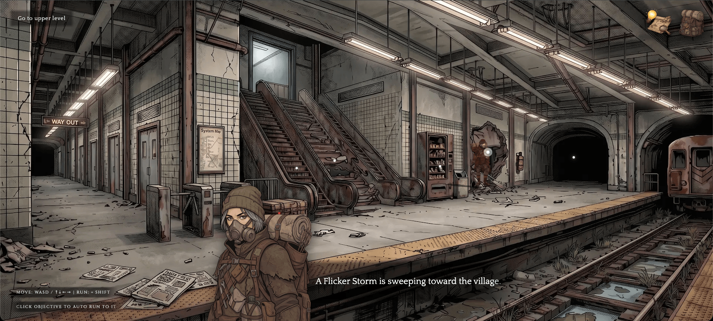

<div align="center">

# SCAVENDER

**A 2.5D, hand-drawn style, point-and-click survival adventure game about a world stuck between two moments in time.**

*Built with React Three Fiber, rendered in the browser.*

🏆 **Ranked #81 at [Vibe Jam 2026](https://vibejam.com/)**



</div>

---

> *They told us the experiment would give us forever. Free energy. Unlimited time.*
>
> *Instead, forever happened all at once. The world didn't end with a bang... it ended with a stutter.*

Half the world is frozen in the **time static**, with people locked mid-step like echoes of a memory. The other half has rotted into a rusted wasteland. You play as **Jace Miller**, a scavenger who isn't living in the past and is barely surviving the present. A **Flicker Storm** is sweeping toward your village, and a strange signal is pulling you underground.

Follow it. Scavenge what you can. And whatever you hear moving in the dark, don't stop.

## ✦ The Journey

| Chapter | What waits for you |
| --- | --- |
| **I · The Metro** | A collapsed subway station full of rusted turnstiles, dead escalators and a vending machine that still remembers what snacks cost. Pry open chests, rewire panels and find the way out. |
| **II · The Refinery** | Something big lives down here. Gather fuel, sulfate and a spark for one very large blast, and try not to become part of the scrap. |
| **III · The Ghost Lab** | The source of the signal. Scientists frozen mid-task, a reactor humming in the dark, and a stranger who seems to know you a little *too* well. |

The game ends in **three possible endings**, one of them a secret. What you pick up along the way matters more than it seems. 👀

<details>
<summary><b>Spoiler hint for the secret ending</b></summary>

<br>

Not everything frozen in the Metro is just scenery. Look closely at the people stuck in the static, and check the back of anything that glows.

</details>

## ✦ How to Play

| Action | Control |
| --- | --- |
| Move | `WASD` / `↑ ↓ ← →` |
| Run | hold `Shift` |
| Walk to and interact with a spot | **Click** it (Jace auto-walks there) |
| Check your backpack | Backpack icon, top-right |
| Toggle hints | Lightbulb icon, top-right, or **Enable Hints** on the title screen |

It's playable on mobile too: tap to move, and the game goes fullscreen and asks you to rotate to landscape.

## ✦ Under the Hood

Scavender layers a **live 3D scene on top of illustrated 2D backgrounds**. Each room is a single 1920×1080 painting, and Three.js handles the characters, lighting and shadows so they sit inside it.

- **2.5D compositing.** A per-room camera rig (height, FOV, look-at) is tuned so the 3D floor lines up with the painted perspective. Rigged GLB models for Jace and everyone (and everything) you meet walk, run and idle on top.
- **Image-space walkable areas.** Walkable floors and clickable hotspots are polygons in normalized image coordinates, so they stay locked to the artwork at any screen size or aspect ratio.
- **Data-driven rooms.** Every interactive zone is plain config: required items, dialog before and after, rewards, puzzle IDs and room transitions. Adding a new interaction doesn't require new code.
- **Point-and-click pathing.** Click a hotspot and Jace walks to it on their own, then triggers the interaction on arrival. Keyboard movement still works whenever you want it.
- **Persistent inventory.** A Zustand store saved to `localStorage`, so your backpack survives a refresh and carries certain items across chapters.
- **Built-in level editor.** With debug mode on, a [Leva](https://github.com/pmndrs/leva) panel exposes in-browser **boundary and zone editors** for drawing polygons directly on the background, plus live tuning for lights, camera, walk speed and enemy behavior.
- **Smooth loading.** Backgrounds, portraits, puzzle art and GLBs are preloaded one chapter ahead, and each stage fades in.

### Stack

[React 19](https://react.dev) · [Three.js](https://threejs.org) · [React Three Fiber](https://r3f.docs.pmnd.rs) · [Drei](https://github.com/pmndrs/drei) · [Zustand](https://github.com/pmndrs/zustand) · [React Router](https://reactrouter.com) · [Leva](https://github.com/pmndrs/leva) · [Vite](https://vite.dev) · [TypeScript](https://www.typescriptlang.org) · deployed on [Cloudflare Workers](https://developers.cloudflare.com/workers/)

## ✦ Running Locally

```bash
npm install
npm run dev
```

Then open the URL Vite prints (usually `http://localhost:5173`).

### Debug / editor mode

```bash
cp .env.example .env
# then set:
VITE_ENABLE_DEBUG=true
```

This shows the Leva panel with the boundary and zone editors, camera and lighting controls, and enemy tuning (including a handy *disable game over*).

### Scripts

| Command | Description |
| --- | --- |
| `npm run dev` | Start the Vite dev server with HMR |
| `npm run build` | Type-check and build for production |
| `npm run lint` | Run ESLint |
| `npm run preview` | Build, then serve locally with `wrangler dev` |
| `npm run deploy` | Build and deploy to Cloudflare Workers |

## ✦ Project Layout

```
src/
├── pages/        # Title screen, chapter intros, the three stages, endings, game over
├── components/   # Scene, characters, HUD, dialog,
│                 # inventory, puzzles, and the boundary/zone editors
├── hooks/        # Keyboard input, walkable boundary, interactive zones
├── store/        # Persistent inventory (Zustand)
├── config/       # Item definitions
└── utils/        # Image-space math, asset preloading
public/assets/
├── glb/          # Rigged character models
├── images/       # Backgrounds, intros, endings, portraits, items, puzzles
└── audio/        # Per-chapter ambient tracks
```

## ✦ License

Released under the [MIT License](./LICENSE). This covers both the code and the game assets (art, models, audio and story).

---

<div align="center">

*The signal is getting stronger.*

</div>
